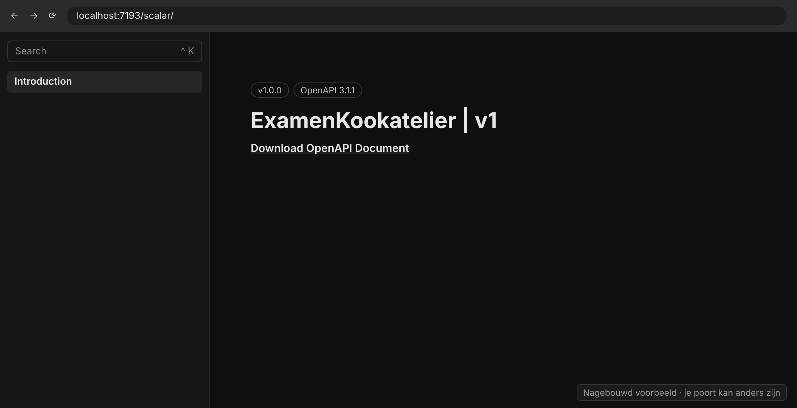
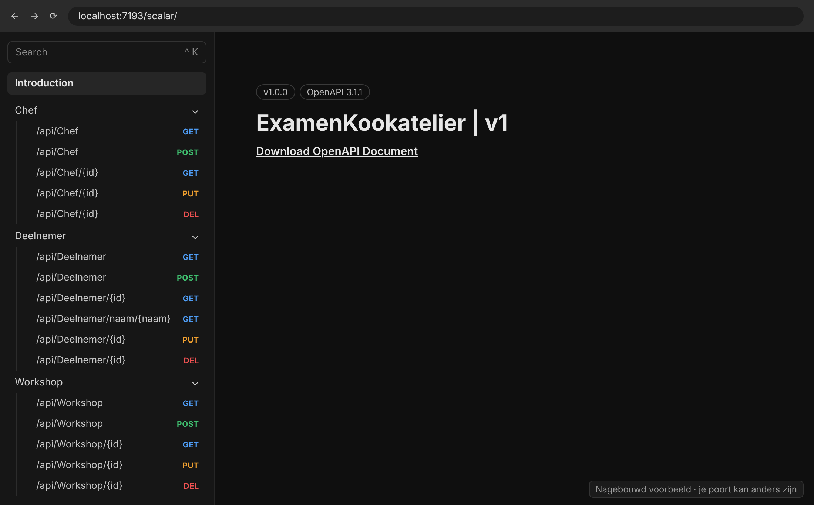
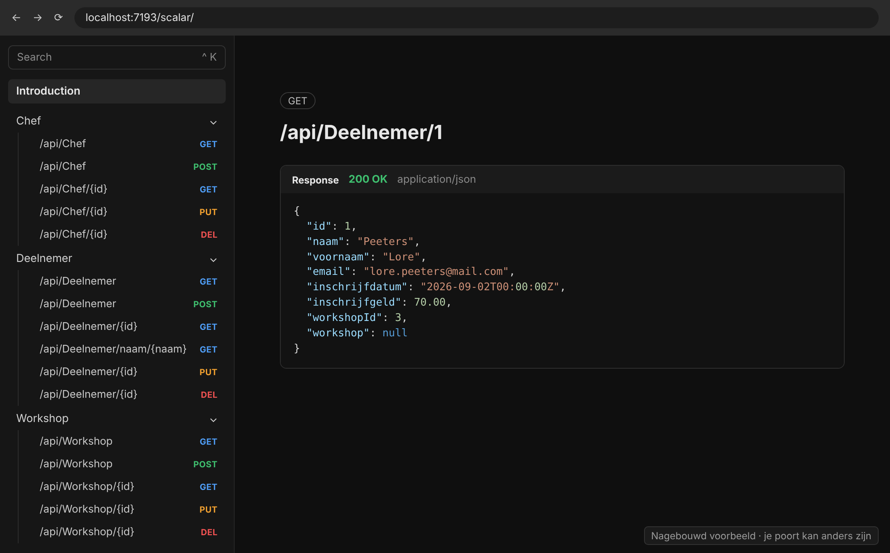

# Examenoefening 02 — Kookatelier

**HOOFDSTUK 01 TOT 06 IN ÉÉN KEER · MET EEN BEDRAG · KORTE GEHEUGENSTEUN · 75 TOT 90 MINUTEN · V3**

Deze oefening vervangt de sportclub. Die staat volledig uitgewerkt in hoofdstuk 43 van je leerboek, en was dus geen oefening meer.

## Startbestanden

Je maakt zelf een volledig nieuw ASP.NET Core Web API-project. Noem het `ExamenKookatelier`.

In de map `Startbestanden` vind je `docker-compose.yml` en `Seed_Data.txt`. De handleiding neem je van je tussentijds examen, `Installatie Docker.docx`, met aangepaste namen.

Zorg dat je project is opgemaakt zoals gezien tijdens de les.

## Opmaak datamodel

In dit project werk je met deelnemers, chefs en workshops. Elke deelnemer kan maar voor één workshop ingeschreven zijn, en in één workshop zitten meerdere deelnemers. Een chef kan meerdere workshops geven, maar een workshop heeft ook meerdere chefs. Maak hiervoor de nodige modellen aan en zet de nodige relaties.

- Opmaak Deelnemer: Id (Int), Naam (String), Voornaam (String), Email (String), Inschrijfdatum (DateTime), Inschrijfgeld (Decimal)
- Opmaak Chef: Id (Int), Naam (String), Voornaam (String), Email (String)
- Opmaak Workshop: Id (Int), Naam (String), Lokaal (String)

LET OP de relaties zijn hier nog niet aan toegevoegd.

## Repositories en controllers

Onderstaande puntjes moeten allemaal mogelijk zijn in Scalar:

- Zorg dat je een lijst van alle chefs, workshops en deelnemers kan opvragen.
- Zorg dat je een chef, workshop en deelnemer kan opvragen, toevoegen, aanpassen en verwijderen. (Opvragen moet met de Id gebeuren)
- Zorg ervoor wanneer er een deelnemer, chef of workshop verwijderd wordt dat er geen corrupte data in de database kan geraken.
- Zorg ervoor dat je de deelnemers ook kan opvragen aan de hand van hun naam.

## Geheugensteun per fase

Geen checklist meer: één regel per fase. De volledige uitleg staat in de blauwdruk V2. Hoe elke fase eruitziet als ze lukt, staat achteraan onder *Verwachte uitkomsten*.

| Fase | Waar je aan denkt |
|---|---|
| 0 · Lezen | `Seed_Data.txt` zegt hoe de vreemde sleutel en de tussentabel heten, en welk type het bedrag heeft. |
| 1 · Opzetten | Stop de container van de vorige oefening. Scalar installeer en koppel je zelf. Bouw. |
| 2 · Modellen | Elk veld uit de startgegevens, elke navigation property met een vraagteken. Bouw. |
| 3 · Database | Per relatie: weigeren of mee verwijderen. Het bedrag krijgt een precisie. Eén migratie, en lees ze na. |
| 4 · Repositories | `await` bij wat met de database praat. De Id bij toevoegen. Alle velden bij bijwerken. Bouw. |
| 5 · Controllers | Eén afwerken en testen, dan pas de andere twee. |
| 6 · Indienen | Het bouwt, en het start. |

## Eindcontrole in Scalar

Begin met een database die enkel de startgegevens bevat.

1. De drie lijsten geven 4 chefs, 4 workshops en 6 deelnemers.
2. Een Id die niet bestaat, geeft bij GET, PUT en DELETE een 404.
3. Voeg een deelnemer toe zonder Id in de body, met een inschrijfgeld van `72.25`. Je krijgt 201, met Id 7. In pgAdmin staat het bedrag er met twee cijfers na de komma.
4. Werk deelnemer 1 bij: een ander inschrijfgeld en een andere workshop. Vraag hem opnieuw op: allebei zijn gewijzigd.
5. Zoek op de naam `Peeters`: je krijgt twee deelnemers. Met kleine letters ook.
6. Verwijder workshop 4. Daar hangt niets aan: het lukt.
7. Verwijder workshop 1. Daar hangen deelnemers en chefs aan. Je krijgt geen 500, en er blijft geen deelnemer achter met een workshop die niet bestaat.
8. Verwijder chef 2. Er blijft geen rij achter in de tussentabel die naar hem wijst.

<<<pagina>>>

## Verwachte uitkomsten

Zo ziet het eruit als een fase gelukt is. Leg je eigen scherm ernaast. De Scalar-schermen zijn nagebouwd: je poort, je kleuren en de volgorde van de routes kunnen bij jou anders zijn.

Waar je zelf iets kiest, kan je uitkomst afwijken zonder dat het fout is:

- **De volgorde van de velden** in je JSON volgt de volgorde in je klasse.

- **De volgorde in een lijst** volgt je `OrderBy`. De opgave vraagt geen volgorde. Hieronder staan de lijsten op Id.

- **Je eigen meldingen** bij een 404 of een 400 hebben je eigen tekst.

- **Bedragen** vergelijk je als getal: `65`, `65.0` en `65.00` zijn hetzelfde.

- De namen van de lijsten kies je zelf. Hier staan ze als `deelnemers` en `chefWorkshops`.

### Fase 1 · Opzetten

**`docker compose up -d`**, in de map `Startbestanden`. De eerste keer haalt Docker eerst de images op. Daarna zie je ongeveer dit:

```text
[+] Running 4/4
 ✔ Network startbestanden_default                           Created
 ✔ Volume "startbestanden_postgres_data_examenkookatelier"  Created
 ✔ Container examenkookatelier_container                    Started
 ✔ Container pgadmin_container_ExamenKookatelier            Started
```

In Docker Desktop staan de twee containers groen.

**Bouwen** in Visual Studio:

```text
========== Build: 1 succeeded, 0 failed, 0 up-to-date, 0 skipped ==========
```

**Scalar** opent, nog zonder routes:



### Fase 3 · Database

**`Update-Database`**. Daartussen staan de SQL-opdrachten. Het einde ziet er zo uit:

```text
Build started...
Build succeeded.
…
Applying migration '20261114093512_InitialCreate'.
…
Done.
```

Je ziet geen `fail` bij de verbinding: de container heeft de database al aangemaakt, met de naam uit `POSTGRES_DB`. Zie je er toch één, en daarna `Done.`, dan is dat ook goed.

**In je migratie** staat bij de vreemde sleutel van deelnemer naar workshop het verwijdergedrag dat je koos:

```cs
table.ForeignKey(
    name: "FK_Deelnemers_Workshops_WorkshopId",
    column: x => x.WorkshopId,
    principalTable: "Workshops",
    principalColumn: "Id",
    onDelete: ReferentialAction.Restrict);   // of Cascade
```

**In pgAdmin**, onder *Schemas › public › Tables*. De namen van de tabellen kies je zelf in `ToTable`. Hier staan ze in het meervoud, zoals in de les:

| Tabel | Kolommen | Rijen |
|---|---|---|
| `__EFMigrationsHistory` | `MigrationId`, `ProductVersion` | 1 |
| `Chefs` | `Id`, `Naam`, `Voornaam`, `Email` | 4 |
| `Workshops` | `Id`, `Naam`, `Lokaal` | 4 |
| `Deelnemers` | `Id`, `Naam`, `Voornaam`, `Email`, `Inschrijfdatum`, `Inschrijfgeld`, `WorkshopId` | 6 |
| `ChefWorkshops` | `Id`, `ChefId`, `WorkshopId` | 6 |

Een navigation property is geen kolom. Zie je een kolom `Workshop` of `Deelnemers`, dan klopt er iets niet in je model.

De kolom `Inschrijfgeld` heeft het type `numeric(8,2)`, of de precisie die je koos.

### Fase 4 · Repositories

Bouwen geeft dezelfde regel als in fase 1. In de *Error List* staat geen enkele CS1998 en geen enkele CS8603.

### Fase 5 · Scalar met alle routes



### Eindcontrole, stap voor stap

Elk verzoek doe je in Scalar. Begin met een database die enkel de startgegevens bevat, en doe de stappen in deze volgorde: elke stap gaat verder op de vorige.

#### Stap 1 · De drie lijsten

| Verzoek | Status | Aantal |
|---|---|---|
| `GET /api/Chef` | 200 OK | 4 |
| `GET /api/Deelnemer` | 200 OK | 6 |
| `GET /api/Workshop` | 200 OK | 4 |

Eén deelnemer uit de lijst, `GET /api/Deelnemer`:

```json
[
  {
    "id": 1,
    "naam": "Peeters",
    "voornaam": "Lore",
    "email": "lore.peeters@mail.com",
    "inschrijfdatum": "2026-09-02T00:00:00Z",
    "inschrijfgeld": 65.00,
    "workshopId": 1,
    "workshop": null
  },
  …
]
```

De deelnemers:

| Id | Naam | Voornaam | Inschrijfdatum | Inschrijfgeld | WorkshopId |
|---|---|---|---|---|---|
| 1 | Peeters | Lore | 2026-09-02 | 65.00 | 1 |
| 2 | Claes | Robin | 2026-09-04 | 65.00 | 1 |
| 3 | Peeters | Tibo | 2026-09-07 | 79.50 | 2 |
| 4 | Wouters | Anke | 2026-09-09 | 79.50 | 2 |
| 5 | Hermans | Sam | 2026-09-15 | 54.90 | 3 |
| 6 | Dubois | Elise | 2026-09-18 | 54.90 | 3 |

`GET /api/Workshop/1` geeft één workshop:

```json
{
  "id": 1,
  "naam": "Verse pasta",
  "lokaal": "Keuken A",
  "deelnemers": null,
  "chefWorkshops": null
}
```

De lijsten staan op `null`: Entity Framework Core haalt gerelateerde gegevens niet uit zichzelf op. Dat is les 08.

#### Stap 2 · Een Id die niet bestaat

`GET /api/Deelnemer/99` geeft **404 Not Found**. Met een eigen melding, zoals `NotFound($"…")`, krijg je je tekst terug, zonder aanhalingstekens:

```text
Er is geen deelnemer met Id 99.
```

Zonder melding, met `NotFound()`, maakt ASP.NET Core er zelf dit van:

```json
{
  "type": "https://tools.ietf.org/html/rfc9110#section-15.5.5",
  "title": "Not Found",
  "status": 404,
  "traceId": "00-3f2a…-01"
}
```

Allebei zijn goed. `PUT` en `DELETE` op Id 99 geven ook 404, en er verandert niets.

#### Stap 3 · Een deelnemer toevoegen

`POST /api/Deelnemer`, met deze body. Er staat geen `id` in, en geen `workshop`:

```json
{
  "naam": "Martens",
  "voornaam": "Lien",
  "email": "lien.martens@mail.com",
  "inschrijfdatum": "2026-10-01T00:00:00Z",
  "inschrijfgeld": 72.25,
  "workshopId": 2
}
```

Je krijgt **201 Created**, met in de headers:

```text
location: https://localhost:7193/api/Deelnemer/7
```

En in de body het nieuwe item, met zijn Id:

```json
{
  "id": 7,
  "naam": "Martens",
  "voornaam": "Lien",
  "email": "lien.martens@mail.com",
  "inschrijfdatum": "2026-10-01T00:00:00Z",
  "inschrijfgeld": 72.25,
  "workshopId": 2,
  "workshop": null
}
```

Krijg je hier een **500** met *23505: duplicate key*, dan negeert je repository de Id nog niet: de teller van PostgreSQL botst met je startgegevens.

In pgAdmin staat in de kolom `Inschrijfgeld` nu `72.25`.

#### Stap 4 · Een deelnemer bijwerken

`PUT /api/Deelnemer/1`, met deze body:

```json
{
  "id": 1,
  "naam": "Peeters",
  "voornaam": "Lore",
  "email": "lore.peeters@mail.com",
  "inschrijfdatum": "2026-09-02T00:00:00Z",
  "inschrijfgeld": 70.00,
  "workshopId": 3
}
```

Je krijgt **204 No Content**, zonder body. Vraag hem daarna opnieuw op, met `GET /api/Deelnemer/1`:

```json
{
  "id": 1,
  "naam": "Peeters",
  "voornaam": "Lore",
  "email": "lore.peeters@mail.com",
  "inschrijfdatum": "2026-09-02T00:00:00Z",
  "inschrijfgeld": 70.00,
  "workshopId": 3,
  "workshop": null
}
```

Gewijzigd: `inschrijfgeld` en `workshopId`. Staat er nog de oude waarde, dan neemt je repository niet alle velden over.

#### Stap 5 · Zoeken op naam

`GET /api/Deelnemer/naam/Peeters` geeft **200 OK** met 2 deelnemers:

```json
[
  {
    "id": 1,
    "naam": "Peeters",
    "voornaam": "Lore",
    "email": "lore.peeters@mail.com",
    "inschrijfdatum": "2026-09-02T00:00:00Z",
    "inschrijfgeld": 70.00,
    "workshopId": 3,
    "workshop": null
  },
  {
    "id": 3,
    "naam": "Peeters",
    "voornaam": "Tibo",
    "email": "tibo.peeters@mail.com",
    "inschrijfdatum": "2026-09-07T00:00:00Z",
    "inschrijfgeld": 79.50,
    "workshopId": 2,
    "workshop": null
  }
]
```

Met `peeters`, in kleine letters, krijg je dezelfde twee. Een naam die niet bestaat, zoals `Xyz`, geeft **200 OK** met `[]`: zo vragen de schoolopgaven het.

#### Stap 6 · Een workshop zonder deelnemers verwijderen

`DELETE /api/Workshop/4` geeft **204 No Content**. `GET /api/Workshop` geeft er nu 3.

#### Stap 7 · Een workshop met deelnemers verwijderen

Aan workshop 1 hangen nu deelnemer 2 (deelnemer 1 verhuisde in stap 4), en in de tussentabel de rijen 1 en 2.

`DELETE /api/Workshop/1` geeft, naargelang wat je koos:

| Je koos | Status | Wat er overblijft |
|---|---|---|
| weigeren, en je controller kijkt vooraf | 400 Bad Request, met je melding | alles: workshop 1 staat er nog, net als deelnemer 2 |
| mee verwijderen | 204 No Content | workshop 1 is weg, deelnemer 2 ook, en de rijen 1 en 2 in de tussentabel |
| weigeren, maar je controller kijkt niet | 500, met *23503: foreign key* | alles staat er nog, maar de client krijgt een crash: dit is fout |

Voorbeeld van een melding bij 400:

```text
Workshop 1 heeft nog deelnemers en kan niet verwijderd worden.
```

#### Stap 8 · Een chef verwijderen

`DELETE /api/Chef/2` geeft **204 No Content**. In pgAdmin zijn alle rijen met `ChefId` 2 weg uit de tussentabel:

| Je koos in stap 7 | Rijen die nu verdwijnen |
|---|---|
| weigeren | 2 en 3 |
| mee verwijderen | 3: rij 2 was al weg |

Krijg je een **500** met *23503: foreign key*, dan staat de relatie op weigeren en ruimt niemand de koppelingen op. Kies mee verwijderen, of verwijder ze eerst in je repository.

#### Zo ziet een antwoord eruit in Scalar


