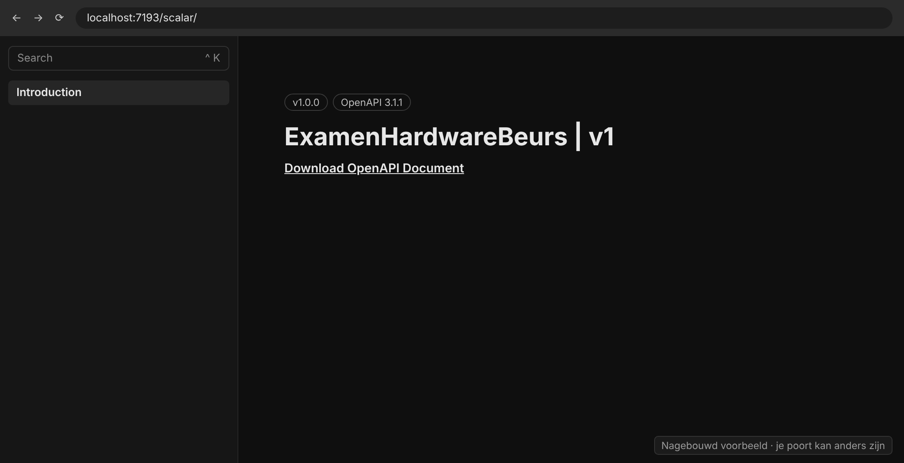
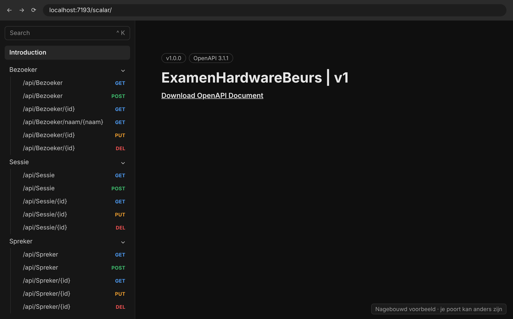
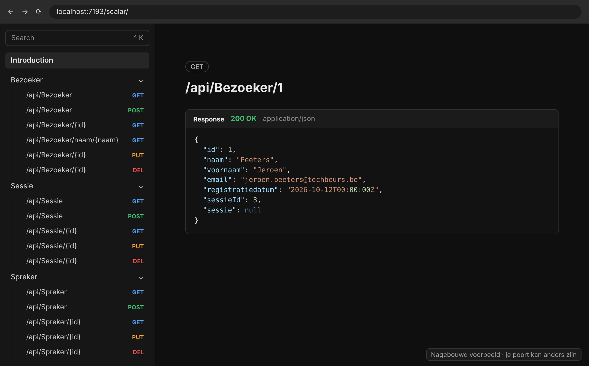

# Examenoefening 03 — HardwareBeurs

**HOOFDSTUK 01 TOT 06 IN ÉÉN KEER · EXAMENSIMULATIE ZONDER HULP · OP TIJD: 75 MINUTEN · V3**

Dit is de opgave zoals je ze op het examen krijgt: zonder checklist en zonder geheugensteun. Zet een wekker. Open de eindcontrole pas als de tijd om is.

## Startbestanden

Je gaat zelf een volledig nieuw project moeten aanmaken. Noem dit project `ExamenHardwareBeurs`.

De startbestanden vind je in de map `Startbestanden`: de docker file voor je database, en de seed data voor je modellen. De handleiding neem je van je tussentijds examen, `Installatie Docker.docx`, met aangepaste namen.

Zorg ervoor dat je examen is opgemaakt zoals gezien tijdens de les.

## Opmaak datamodel

In dit project gaan we werken met bezoekers, sprekers en sessies. Elke bezoeker kan maar voor één sessie ingeschreven zijn. En in één sessie zitten meerdere bezoekers. Een spreker kan voor meerdere sessies staan, maar een sessie heeft ook meerdere sprekers. Maak hiervoor de nodige modellen aan en zet de nodige relaties.

- Opmaak Bezoeker: Id (Int), Naam (String), Voornaam (String), Email (String), Registratiedatum (DateTime)
- Opmaak Spreker: Id (Int), Naam (String), Voornaam (String), Email (String)
- Opmaak Sessie: Id (Int), Naam (String), Zaal (String)

LET OP de relaties zijn hier nog niet aan toegevoegd.

## Repositories en controllers

Onderstaande puntjes moeten allemaal mogelijk zijn in Scalar:

- Zorg dat je een lijst van alle sprekers, sessies en bezoekers kan opvragen.
- Zorg dat je een spreker, sessie en bezoeker kan opvragen, toevoegen, aanpassen en verwijderen. (Opvragen moet met de Id gebeuren)
- Zorg ervoor wanneer er een bezoeker, spreker of sessie verwijderd wordt dat er geen corrupte data in de database kan geraken.
- Zorg ervoor dat je de bezoekers ook kan opvragen aan de hand van hun naam.

Als je klaar bent, toont Scalar deze routes:

| Controller | Routes |
|---|---|
| Spreker | `/api/Spreker` (GET, POST) en `/api/Spreker/{id}` (GET, PUT, DELETE) |
| Sessie | `/api/Sessie` (GET, POST) en `/api/Sessie/{id}` (GET, PUT, DELETE) |
| Bezoeker | `/api/Bezoeker` (GET, POST) en `/api/Bezoeker/{id}` (GET, PUT, DELETE) |

Hoe je het zoeken op naam bereikbaar maakt, kies je zelf.

<<<pagina>>>

## Eindcontrole in Scalar — pas openen als de tijd om is

Begin met een database die enkel de startgegevens bevat. Wat elke stap precies teruggeeft, staat daarna onder *Verwachte uitkomsten*.

1. Het project bouwt zonder fouten, en zonder waarschuwing CS1998 of CS8603.
2. In je map `Migrations` staat precies één migratie.
3. De drie lijsten geven 4 sprekers, 4 sessies en 5 bezoekers.
4. Een Id die niet bestaat, geeft bij GET, PUT en DELETE een 404.
5. Voeg een bezoeker toe zonder Id in de body. Je krijgt 201, met Id 6.
6. Werk bezoeker 1 bij: een ander e-mailadres en een andere sessie. Vraag hem opnieuw op: allebei zijn gewijzigd.
7. Zoek op de naam `Peeters`: je krijgt twee bezoekers. Met kleine letters ook.
8. Verwijder sessie 4. Daar hangt niets aan: het lukt.
9. Verwijder sessie 1. Daar hangen bezoekers en sprekers aan. Je krijgt geen 500, en er blijft geen bezoeker achter met een sessie die niet bestaat.
10. Verwijder spreker 2. Er blijft geen rij achter in de tussentabel die naar haar wijst.

**Hoeveel haalde je?** Tel de stappen die lukken. Minder dan zeven: maak oefening 02 opnieuw, met de blauwdruk ernaast. Zeven of meer: herhaal deze oefening over een week, en mik op 60 minuten.

<<<pagina>>>

## Verwachte uitkomsten

Zo ziet het eruit als een fase gelukt is. Leg je eigen scherm ernaast. De Scalar-schermen zijn nagebouwd: je poort, je kleuren en de volgorde van de routes kunnen bij jou anders zijn.

Waar je zelf iets kiest, kan je uitkomst afwijken zonder dat het fout is:

- **De volgorde van de velden** in je JSON volgt de volgorde in je klasse.

- **De volgorde in een lijst** volgt je `OrderBy`. De opgave vraagt geen volgorde. Hieronder staan de lijsten op Id.

- **Je eigen meldingen** bij een 404 of een 400 hebben je eigen tekst.

- De namen van de lijsten kies je zelf. Hier staan ze als `bezoekers` en `sprekerSessies`.

### Fase 1 · Opzetten

**`docker compose up -d`**, in de map `Startbestanden`. De eerste keer haalt Docker eerst de images op. Daarna zie je ongeveer dit:

```text
[+] Running 4/4
 ✔ Network startbestanden_default                             Created
 ✔ Volume "startbestanden_postgres_data_examenhardwarebeurs"  Created
 ✔ Container examenhardwarebeurs_container                    Started
 ✔ Container pgadmin_container_ExamenHardwareBeurs            Started
```

In Docker Desktop staan de twee containers groen.

**Bouwen** in Visual Studio:

```text
========== Build: 1 succeeded, 0 failed, 0 up-to-date, 0 skipped ==========
```

**Scalar** opent, nog zonder routes:



### Fase 3 · Database

**`Update-Database`**. Daartussen staan de SQL-opdrachten. Het einde ziet er zo uit:

```text
Build started...
Build succeeded.
…
Applying migration '20261114093512_InitialCreate'.
…
Done.
```

Je ziet geen `fail` bij de verbinding: de container heeft de database al aangemaakt, met de naam uit `POSTGRES_DB`. Zie je er toch één, en daarna `Done.`, dan is dat ook goed.

**In je migratie** staat bij de vreemde sleutel van bezoeker naar sessie het verwijdergedrag dat je koos:

```cs
table.ForeignKey(
    name: "FK_Bezoekers_Sessies_SessieId",
    column: x => x.SessieId,
    principalTable: "Sessies",
    principalColumn: "Id",
    onDelete: ReferentialAction.Restrict);   // of Cascade
```

**In pgAdmin**, onder *Schemas › public › Tables*. De namen van de tabellen kies je zelf in `ToTable`. Hier staan ze in het meervoud, zoals in de les:

| Tabel | Kolommen | Rijen |
|---|---|---|
| `__EFMigrationsHistory` | `MigrationId`, `ProductVersion` | 1 |
| `Sprekers` | `Id`, `Naam`, `Voornaam`, `Email` | 4 |
| `Sessies` | `Id`, `Naam`, `Zaal` | 4 |
| `Bezoekers` | `Id`, `Naam`, `Voornaam`, `Email`, `Registratiedatum`, `SessieId` | 5 |
| `SprekerSessies` | `Id`, `SprekerId`, `SessieId` | 6 |

Een navigation property is geen kolom. Zie je een kolom `Sessie` of `Bezoekers`, dan klopt er iets niet in je model.

### Fase 4 · Repositories

Bouwen geeft dezelfde regel als in fase 1. In de *Error List* staat geen enkele CS1998 en geen enkele CS8603.

### Fase 5 · Scalar met alle routes



Zoek je op naam met een parameter uit de query string, dan zie je de route met `naam` niet: je zoekt dan via `GET /api/Bezoeker?naam=…`.

### Eindcontrole, stap voor stap

Elk verzoek doe je in Scalar. Begin met een database die enkel de startgegevens bevat, en doe de stappen in deze volgorde: elke stap gaat verder op de vorige.

#### Stap 1 · Bouwen

Zie fase 4: nul fouten, en geen CS1998 of CS8603.

#### Stap 2 · Eén migratie

In je map `Migrations` staan twee bestanden met `InitialCreate` in de naam, en één `…ModelSnapshot.cs`. In `__EFMigrationsHistory` staat één rij.

#### Stap 3 · De drie lijsten

| Verzoek | Status | Aantal |
|---|---|---|
| `GET /api/Bezoeker` | 200 OK | 5 |
| `GET /api/Sessie` | 200 OK | 4 |
| `GET /api/Spreker` | 200 OK | 4 |

Eén bezoeker uit de lijst, `GET /api/Bezoeker`:

```json
[
  {
    "id": 1,
    "naam": "Peeters",
    "voornaam": "Jeroen",
    "email": "jeroen.peeters@mail.com",
    "registratiedatum": "2026-10-12T00:00:00Z",
    "sessieId": 1,
    "sessie": null
  },
  …
]
```

De bezoekers:

| Id | Naam | Voornaam | Registratiedatum | SessieId |
|---|---|---|---|---|
| 1 | Peeters | Jeroen | 2026-10-12 | 1 |
| 2 | Willems | Sofie | 2026-10-14 | 1 |
| 3 | Janssens | Ruben | 2026-10-15 | 2 |
| 4 | Peeters | Eline | 2026-10-18 | 2 |
| 5 | Maes | Gilles | 2026-10-20 | 3 |

`GET /api/Sessie/1` geeft één sessie:

```json
{
  "id": 1,
  "naam": "Airflow en Casefans",
  "zaal": "Hal A",
  "bezoekers": null,
  "sprekerSessies": null
}
```

De lijsten staan op `null`: Entity Framework Core haalt gerelateerde gegevens niet uit zichzelf op. Dat is les 08.

#### Stap 4 · Een Id die niet bestaat

`GET /api/Bezoeker/99` geeft **404 Not Found**. Met een eigen melding, zoals `NotFound($"…")`, krijg je je tekst terug, zonder aanhalingstekens:

```text
Er is geen bezoeker met Id 99.
```

Zonder melding, met `NotFound()`, maakt ASP.NET Core er zelf dit van:

```json
{
  "type": "https://tools.ietf.org/html/rfc9110#section-15.5.5",
  "title": "Not Found",
  "status": 404,
  "traceId": "00-3f2a…-01"
}
```

Allebei zijn goed. `PUT` en `DELETE` op Id 99 geven ook 404, en er verandert niets.

#### Stap 5 · Een bezoeker toevoegen

`POST /api/Bezoeker`, met deze body. Er staat geen `id` in, en geen `sessie`:

```json
{
  "naam": "Martens",
  "voornaam": "Lien",
  "email": "lien.martens@mail.com",
  "registratiedatum": "2026-10-25T00:00:00Z",
  "sessieId": 2
}
```

Je krijgt **201 Created**, met in de headers:

```text
location: https://localhost:7193/api/Bezoeker/6
```

En in de body het nieuwe item, met zijn Id:

```json
{
  "id": 6,
  "naam": "Martens",
  "voornaam": "Lien",
  "email": "lien.martens@mail.com",
  "registratiedatum": "2026-10-25T00:00:00Z",
  "sessieId": 2,
  "sessie": null
}
```

Krijg je hier een **500** met *23505: duplicate key*, dan negeert je repository de Id nog niet: de teller van PostgreSQL botst met je startgegevens.

#### Stap 6 · Een bezoeker bijwerken

`PUT /api/Bezoeker/1`, met deze body:

```json
{
  "id": 1,
  "naam": "Peeters",
  "voornaam": "Jeroen",
  "email": "jeroen.peeters@techbeurs.be",
  "registratiedatum": "2026-10-12T00:00:00Z",
  "sessieId": 3
}
```

Je krijgt **204 No Content**, zonder body. Vraag hem daarna opnieuw op, met `GET /api/Bezoeker/1`:

```json
{
  "id": 1,
  "naam": "Peeters",
  "voornaam": "Jeroen",
  "email": "jeroen.peeters@techbeurs.be",
  "registratiedatum": "2026-10-12T00:00:00Z",
  "sessieId": 3,
  "sessie": null
}
```

Gewijzigd: `email` en `sessieId`. Staat er nog de oude waarde, dan neemt je repository niet alle velden over.

#### Stap 7 · Zoeken op naam

`GET /api/Bezoeker/naam/Peeters`, of `GET /api/Bezoeker?naam=Peeters`, wat je ook koos. Je krijgt **200 OK** met 2 bezoekers:

```json
[
  {
    "id": 1,
    "naam": "Peeters",
    "voornaam": "Jeroen",
    "email": "jeroen.peeters@techbeurs.be",
    "registratiedatum": "2026-10-12T00:00:00Z",
    "sessieId": 3,
    "sessie": null
  },
  {
    "id": 4,
    "naam": "Peeters",
    "voornaam": "Eline",
    "email": "eline.peeters@mail.com",
    "registratiedatum": "2026-10-18T00:00:00Z",
    "sessieId": 2,
    "sessie": null
  }
]
```

Met `peeters`, in kleine letters, krijg je dezelfde twee. Een naam die niet bestaat, zoals `Xyz`, geeft **200 OK** met `[]`: zo vragen de schoolopgaven het.

#### Stap 8 · Een sessie zonder bezoekers verwijderen

`DELETE /api/Sessie/4` geeft **204 No Content**. `GET /api/Sessie` geeft er nu 3.

#### Stap 9 · Een sessie met bezoekers verwijderen

Aan sessie 1 hangen nu bezoeker 2 (bezoeker 1 verhuisde in stap 6), en in de tussentabel de rijen 1 en 2.

`DELETE /api/Sessie/1` geeft, naargelang wat je koos:

| Je koos | Status | Wat er overblijft |
|---|---|---|
| weigeren, en je controller kijkt vooraf | 400 Bad Request, met je melding | alles: sessie 1 staat er nog, net als bezoeker 2 |
| mee verwijderen | 204 No Content | sessie 1 is weg, bezoeker 2 ook, en de rijen 1 en 2 in de tussentabel |
| weigeren, maar je controller kijkt niet | 500, met *23503: foreign key* | alles staat er nog, maar de client krijgt een crash: dit is fout |

Voorbeeld van een melding bij 400:

```text
Sessie 1 heeft nog bezoekers en kan niet verwijderd worden.
```

#### Stap 10 · Een spreker verwijderen

`DELETE /api/Spreker/2` geeft **204 No Content**. In pgAdmin zijn alle rijen met `SprekerId` 2 weg uit de tussentabel:

| Je koos in stap 9 | Rijen die nu verdwijnen |
|---|---|
| weigeren | 2 en 3 |
| mee verwijderen | 3: rij 2 was al weg |

Krijg je een **500** met *23503: foreign key*, dan staat de relatie op weigeren en ruimt niemand de koppelingen op. Kies mee verwijderen, of verwijder ze eerst in je repository.

#### Zo ziet een antwoord eruit in Scalar


